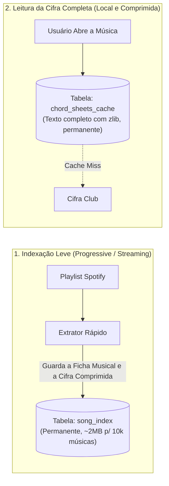

# Arquitetura, Banco de Dados e Motor de Dificuldade do Cifrafy

## 1. O Problema da Busca & Por que o Banco NÃO Fica Pesado

### A Dúvida: *"Quanto mais cifras procurarmos, mais pesado ficará o banco?"*
A resposta curta é: **Só fica pesado se salvarmos a letra/cifra bruta inteira (`raw_chord_sheet`) dentro da tabela principal de busca.**

Vamos fazer a conta real de armazenamento:
- Uma página de cifra completa (`raw_chord_sheet` com letra + espaços + tablaturas) ocupa cerca de **3 KB a 6 KB** de texto.
- Mas os **metadados musicais extraídos** de uma música ocupam apenas **~200 bytes**!
  Exemplo do que realmente precisamos para filtrar/recomendar:
  ```json
  {
    "spotify_track_id": "4uLU6hMCjMI75M1A2tKUQC",
    "artist": "Legião Urbana",
    "title": "Tempo Perdido",
    "cifra_url": "https://www.cifraclub.com.br/legiao-urbana/tempo-perdido/",
    "has_simplified_url": true,
    "musical_key": "G",
    "chord_frequencies": {"C": 34, "Am": 32, "Bm": 30, "Em": 35},
    "total_chord_changes": 131,
    "avg_changes_per_line": 2.4,
    "has_tabs": true
  }
  ```
- **Quanto ocupam 10.000 músicas** salvando apenas essa ficha técnica de 200 bytes?
  **Apenas ~2 MB (dois megabytes)!** O SQLite lê e filtra 10.000 registros de 200 bytes em menos de **1 milissegundo**.

---

## 2. Estratégia de Armazenamento em 2 Níveis (Hot Index vs. Cold/On-Demand Sheet)

Para manter o banco **ultraleve** e a busca **instantânea**, separamos o banco em duas camadas:



### Como o sync funciona

1. Você abre a playlist e escolhe as faixas, até 15 por lote.
2. Um limitador global faz uma requisição por vez ao Cifra Club, com intervalo mínimo. Ao receber 403 ou 429, ele entra em cooldown e o restante do lote volta como pendente.
3. A mesma requisição extrai os acordes para `song_index` e guarda a cifra completa comprimida com `zlib` em `chord_sheets_cache`.
4. Abrir uma música sincronizada não acessa o site. Nenhuma cifra é apagada automaticamente.

---

## 3. Modelagem do Banco de Dados (SQLite / PostgreSQL Ready)

A estrutura abaixo foi desenhada em SQL padrão para rodar em **SQLite** (arquivo único em `backend/data/guitar.db` mapeado por volume no Docker) e poder migrar para PostgreSQL sem mudar uma linha de código se um dia virar SaaS:

### Tabela 1: `song_index` (Catálogo Leve & Permanente — ~200 bytes/música)
Guarda a anatomia harmônica da música. **Não depende do nível do usuário** (pois a música em si não muda quando você aprende um acorde novo).

| Coluna | Tipo | Descrição |
| :--- | :--- | :--- |
| `id` | ` INTEGER PRIMARY KEY` | ID interno |
| `artist_slug` | `TEXT NOT NULL` | Ex: `legiao-urbana` |
| `track_slug` | `TEXT NOT NULL` | Ex: `tempo-perdido` |
| `spotify_track_id` | `TEXT` | ID original da faixa no Spotify (indexado) |
| `artist_name` | `TEXT NOT NULL` | Nome de exibição do artista |
| `track_name` | `TEXT NOT NULL` | Nome limpo da faixa |
| `cifra_url` | `TEXT` | URL canônica no Cifra Club |
| `has_simplified` | `BOOLEAN` | Se existe `/simplificada.html` no Cifra Club |
| `musical_key` | `TEXT` | Tom original (ex: `G`, `Am`) |
| `unique_chords_count` | `INTEGER` | Quantidade de acordes únicos (permite `WHERE unique_chords_count <= 4`) |
| `has_barre_chords` | `BOOLEAN` | Flag rápida se a versão original tem pestana |
| `chord_frequencies_json`| `TEXT (JSON)` | Ex: `{"G": 42, "D": 38, "Em": 35, "C": 34, "Bm": 2}` |
| ` simplified_chords_json`| `TEXT (JSON)` | Frequência dos acordes na versão `/simplificada.html` (se houver) |
| `total_chord_events` | `INTEGER` | Soma total de trocas de acorde na música |
| `avg_changes_per_line` | `REAL` | Densidade de troca (acordes por linha com letra) |
| `has_tabs` | `BOOLEAN` | Se possui bloco de tablatura (`E\|---`) |
| `best_capo_fret` | `INTEGER` | Casa do capotraste que zera/minimiza pestanas (0 a 11) |
| `best_capo_chords_json` | `TEXT (JSON)` | Acordes resultantes usando o capotraste sugerido |
| `updated_at` | `TIMESTAMP` | Data da indexação |

> [!IMPORTANT]
> Repare nas colunas pré-calculadas `unique_chords_count`, `has_barre_chords` e `best_capo_fret`: elas permitem fazer queries SQL diretas como:
> `SELECT * FROM song_index WHERE unique_chords_count <= 4 AND has_barre_chords = 0`!

### Tabela 2: `chord_sheets_cache` (Cifras Completas)
Guarda permanentemente o texto completo de cada cifra baixada.

| Coluna | Tipo | Descrição |
| :--- | :--- | :--- |
| `song_id` | `INTEGER PRIMARY KEY` | FK para `song_index.id` |
| `compressed_sheet` | `BLOB` | Cifra completa comprimida com `zlib` (~70% menor) |
| `compressed_simplified` | `BLOB` | Cifra simplificada comprimida (opcional) |
| `last_accessed_at` | `TIMESTAMP` | Último acesso à cifra |

### Tabela 3: `user_profile` (Seu Perfil)
| Coluna | Tipo | Descrição |
| :--- | :--- | :--- |
| `known_chords_json` | `TEXT (JSON)` | Lista de acordes dominados: `["C","G","D","A","E","Am","Em","Dm"]` |
| `learning_chords_json` | `TEXT (JSON)` | Acordes que você está treinando no momento (ex: `["F", "Bm"]`) |
| `avoid_barre` | `BOOLEAN` | Preferência global de evitar pestanas |

### Tabela 4: `repertoire` (Seu Progresso)
| Coluna | Tipo | Descrição |
| :--- | :--- | :--- |
| `song_id` | `INTEGER PRIMARY KEY` | FK para `song_index.id` |
| `status` | `TEXT` | `want`, `practicing` ou `mastered` |
| `preferred_semitones` | `INTEGER` | Transposição preferida (-11 a 11) |
| `preferred_capo` | `INTEGER` | Capotraste preferido (0 a 11) |
| `updated_at` | `TIMESTAMP` | Última alteração |

---

## 4. O Motor de Dificuldade (Como Calculamos a Qualidade de Verdade)

Para classificar uma música de forma inteligente e justa para um violonista, nosso módulo `src/core/analyzer.py` avalia **5 dimensões**:

### Dimensão 1: Taxonomia e Peso de Complexidade dos Acordes (`CHORD_WEIGHTS`)
Todo acorde extraído passa por um parser que separa:
- **Fundamental (Root):** `C`, `C#`, `D`, `Eb`, `E`, `F`, `F#`, `G`, `G#`, `A`, `Bb`, `B`
- **Qualidade/Extensão:** `m`, `7`, `7M`, `9`, `sus4`, `dim`, `m7(b5)`, etc.
- **Baixo Invertido (Slash Chord):** ex: `D/F#`, `C/G`, `G/B`.

Classificamos cada acorde em 4 categorias:
1. **Abertos Básicos (Peso 1.0):** `C, G, D, A, E, Am, Em, Dm, E7, A7, D7, G7, Am7, Em7, Dm7, C7M`.
2. **Abertos com Extensão / Baixo Simples (Peso 1.4):** `C9, D9, Dsus4, Asus2, G/B, C/G, D/F#, F7M(sem pestana)`.
3. **Pestanas Padrão (Peso 3.0):**
   - Qualquer acorde com fundamental `F, F#, Gb, B, Bb, A#, C#, Db, G#, Ab, D#, Eb` (exceto `F7M` aberto).
   - Acordes menores/sétima em fôrma fechada: `Cm, Gm, Dm(na 5ª casa se aplicável, mas Dm aberto é livre)`.
4. **Dissonantes / Jazz / Pestanas Complexas (Peso 4.5):**
   - Acordes com `dim`, `°`, `m7(b5)`, `7(b9)`, `7(#11)`, `7(b13)`, `6(9)` ou baixos invertidos com pestana (`F/A`, `Bb/D`).

### Dimensão 2: Frequência Ponderada vs. "Acorde Intruso"
Em vez de tratar todos os acordes da lista `unique_chords` com o mesmo peso, usamos `chord_frequencies`:
- Se uma música tem 100 trocas de acorde no total:
  - `G` (35x), `D` (32x), `Em` (31x) $\rightarrow$ **98% da música** são 3 acordes abertos básicos.
  - `Bm` (2x) $\rightarrow$ **2% da música** é uma pestana.
- **Detecção de Acorde Intruso (`rare_hard_chords`):**
  - Qualquer pestana ou acorde desconhecido que represente **menos de 4% do total de acordes da música e apareça no máximo 2 vezes** é marcado como `intruso/opcional`.
  - A interface avisa: *"Fácil (98% conhecida — possui apenas 1 `Bm` isolado que você pode pular ou substituir)"*.

### Dimensão 3: Densidade Harmônica (`avg_changes_per_line`)
Contamos quantos acordes existem em média para cada linha de letra da música:
- **Baixa densidade ($\le 2.5$ acordes/linha):** Ritmo tranquilo, bastante tempo para montar o próximo acorde.
- **Média densidade ($2.6$ a $4.0$ acordes/linha):** Trocas a cada meia frase.
- **Alta densidade ($> 4.0$ acordes/linha):** Trocas rápidas (comum em Samba, Bossa Nova, MPB complexa). Reduz o score usado na ordenação, sem mudar o nível.

### Dimensão 4: Cobertura do Usuário (`known_coverage_pct`)
Calculamos duas métricas contra a sua lista `known_chords`:
- **Match Único (`unique_match_pct`):** `%` dos acordes únicos que você conhece (ex: conhece 3 de 4 = 75%).
- **Match Ponderado no Tempo (`weighted_match_pct`):** `%` da música inteira que você consegue tocar com o que já sabe (ex: os 3 acordes que você conhece representam 96% da música!).

### Dimensão 5: Capotraste

Se a música não é Fácil, o analisador procura a menor casa de 1 a 7 em que as formas resultantes ficam Fácil. Quando encontra, a música recebe `easy_with_capo: true` e `capo_suggestion.makes_easy: true`.

---

## 5. Classificação Final e Score

| Nível | Regra |
| :--- | :--- |
| **Fácil** | Nenhuma pestana relevante **e** (até 4 acordes **ou** todos conhecidos) |
| **Médio** | Exatamente 1 obstáculo: 1 acorde novo **ou** 1 pestana |
| **Difícil** | Todo o resto |

Acordes raros são ignorados. Uma pestana já conhecida só conta como obstáculo quando `avoid_barre` está ativo.

O `score` de 0 a 100 serve apenas para ordenar as músicas dentro da lista. Ele combina cobertura dos acordes conhecidos (50), pestanas (25), densidade de trocas (15) e simplicidade (10).

---

## 6. Infraestrutura

- `dev.sh`: sobe backend e frontend com hot-reload e o SQLite Web UI em container.
- `docker-compose.yml`: sobe `cifrafy-backend` (porta 8000, API e MCP) e `cifrafy-frontend` (porta 3000).
